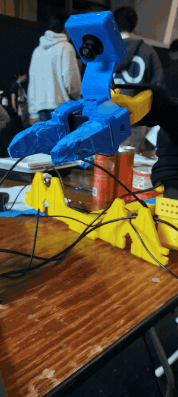

# MindNest

AI-powered conversation platform with robot control integration. Built at **Cal Hacks 12.0** (Oct 24–26, 2025, San Francisco).

> My first hardware project: an SO-101 robot arm driven from a REST API, playing rock-paper-scissors live on the hackathon floor.

  

🎥 **Demo clip (31 s, API call on the laptop -> arm gestures):** [media/so101_calhacks_clip.mp4](media/so101_calhacks_clip.mp4)

### More videos from Cal Hacks 12.0

| Video | What it shows |
|---|---|
| [so101_full_session.mp4](media/so101_full_session.mp4) | Full 2-min session: robot API calls from the laptop and the SO-101 arm responding |
| [so101_closeup.mp4](media/so101_closeup.mp4) | Close-up of the SO-101 arm on the table |
| [chat_simulator_demo.mp4](media/chat_simulator_demo.mp4) | Chat Simulator UI walkthrough (filmed off the laptop screen) |
| [calhacks_floor.mp4](media/calhacks_floor.mp4) | The Cal Hacks 12.0 hacking floor |

## Projects

### 🎭 Chat Simulator (`chat_simulator/`)
Multi-agent AI conversation platform with:
- Dynamic persona creation and management
- Global Meta-Advisor with Letta memory integration
- Real-time conversation simulation
- TLDR summaries (text & video styles)
- Group management

### 🤖 Robot Controller (`bot_code/`)
SO-101 Rock-Paper-Scissors Robot API:
- REST API for robot gesture control
- Rock, Paper, Scissors gestures
- Shake animations and timing controls

## Quick Start

### Chat Simulator
\`\`\`bash
cd chat_simulator
cp .env.example .env  # Add your API keys
uv run main.py
\`\`\`
Visit: http://localhost:8000

### Robot Controller
\`\`\`bash
cd bot_code
uv run api.py
\`\`\`
API: http://localhost:8001

## Features
- Multi-persona AI conversations
- Persistent memory with Letta
- Robot control interface
- Real-time WebSocket updates
- Group-based simulations
